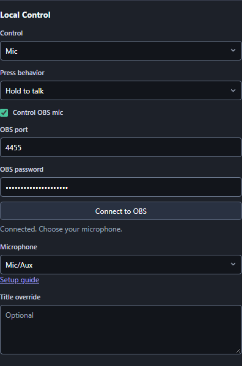

# Hold one button for your microphone and English captions

Hold a Stream Deck button to unmute your OBS microphone and let Caption.Ninja listen. Release it to mute the microphone and stop listening. No Streamer.bot or VDO.Ninja call is needed.

You need the [VDO.Ninja Stream Deck plugin 0.1.17 or newer](https://github.com/steveseguin/vdo-streamdeck/releases/latest), OBS Studio 28 or newer, and Chrome or Edge. Run OBS and Stream Deck on the same computer.

## 1. Create the button

1. Install the plugin, then drag **VDO.Ninja > Local Control** onto an empty Stream Deck key.
2. Set **Control** to **Mic** and **Press behavior** to **Hold to talk**. Use a standalone key, outside a Multi Action.
3. Open **Connect VDO.Ninja**. Copy your connection key, or click **Generate secure key** if you do not have one. Keep this key private.

## 2. Open the German listening page

Open this address in Chrome or Edge. Replace `YOUR_ROOM` with a long name containing letters and numbers. Replace `YOUR_KEY` with your connection key. Use different values for the room and key.

```text
https://caption.ninja/?ver=33&room=YOUR_ROOM&api=YOUR_KEY&lang=de-DE
```

Wait for **API connected**. Listening starts paused. Allow microphone access when asked and keep the tab open. You can switch to another window while using the button.

## 3. Add the English captions to OBS

In OBS, add a **Browser Source** named **Translated captions**. Paste this URL, using the same room name:

```text
https://caption.ninja/overlay?ver=33&room=YOUR_ROOM&translate=en&fromlang=de
```

`lang=de-DE` tells the listening page that you speak German. `translate=en&fromlang=de` tells the OBS overlay to translate German into English. The overlay does not need your private key.

## 4. Connect the OBS microphone

1. In OBS, open **Tools > WebSocket Server Settings**. Enable the server and leave **Enable Authentication** checked. Open **Show Connect Info** and copy the port and password.
2. Select your Stream Deck button. Enable **Control OBS mic**, enter the OBS port (usually `4455`) and password, then click **Connect to OBS**.
3. Choose your microphone from the **Microphone** list. Choose the same source you normally use on your stream.
4. In **OBS > Settings > Audio**, disable **Enable Push-to-Talk** and **Enable Push-to-Mute** for that microphone. This button replaces your old hotkey. Mute the source in OBS's Audio Mixer before testing.



## 5. Make a short test recording

1. Start recording in OBS. Hold the button, wait for **Mic Live** and the browser's microphone indicator, then speak German. Your microphone should unmute and English captions should appear.
2. Release the button and say another sentence. The microphone should mute, and this sentence should not appear.
3. Hold the button again and speak. Both should resume. Play back the recording to check the sound and captions.

The first translation can take longer while the language pack downloads. Words spoken while held may finish translating after release; existing captions stay on screen.

If the key says **Hold Mute**, change **Press behavior** to **Hold to talk**. If **Control OBS mic** is missing, update the plugin. If captions stay in German, check the OBS Browser Source URL includes both `translate=en` and `fromlang=de`. If control stops responding, mute the microphone directly in OBS and click **Stop listening** in Caption.Ninja, or close its tab, before reconnecting.

## Optional: Font and color

Add this to the end of the OBS Browser Source URL for Arial, 48-pixel yellow text:

```text
&font=Arial&fontsize=48px&color=%23fff200
```

Use a font installed on the OBS computer. Change `48px` for the size and `fff200` for the hexadecimal color; keep `%23` before the color.
